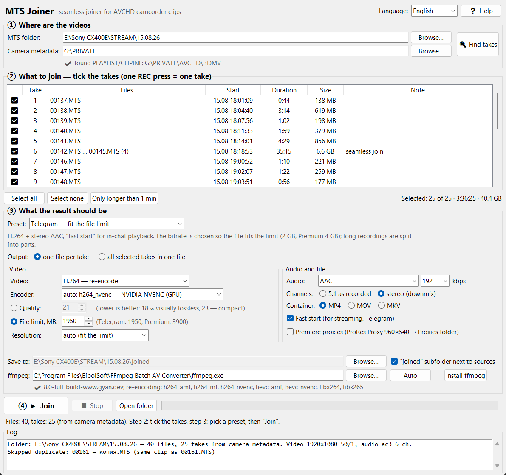

# MTS Joiner — join split camcorder MTS files into one video, losslessly

**[Русская версия →](README.md)**

A free Windows tool that joins the `.MTS` files your AVCHD camcorder split a recording into (Sony
Handycam, Panasonic, Canon, JVC) back into whole recordings — **no re-encoding, no quality loss and no
gaps at the joins** (no black frames or missing audio between clips in Premiere Pro). Plus ready-made
presets for **Premiere editing, YouTube, Telegram** and **compact storage (HEVC)**.



**Download:** [Releases](../../releases) → `MtsJoiner.exe` (no installation needed).

---

## The problem it solves

You film a concert, wedding, lecture or stage show on an AVCHD camcorder — and instead of one
hour-long video the card holds **10-minute files**: `00142.MTS`, `00143.MTS`, `00144.MTS`… The camera
splits the recording into **2 GB** pieces (a memory card file-system limit).

Put those pieces back to back in Premiere Pro (or DaVinci Resolve, Vegas, etc.) and **every join** gets:

- **~0.77 s of black screen with sound** at the start of a piece;
- **~0.77 s of picture without sound** at the end of the previous one.

On top of that: heavy files on an external drive (laggy preview) and **AC3 5.1** audio that Premiere on
a recent Windows 11 may not read at all.

**MTS Joiner** joins the pieces back **byte by byte**, the way the camera recorded them — the joins
disappear completely and the video stays bit-identical to the camera original.

## Features

- 🎬 **Lossless, gapless joining** — video is not re-encoded; camera bitrate and quality.
- 🧠 **Finds the takes itself:** one REC press = one take; long multi-file recordings are assembled
  automatically.
- 📋 **Reads the camera metadata** (`PLAYLIST`/`CLIPINF`): exact recording time, **recognizes renamed
  files**, **names missing ones**, drops duplicates.
- 🧩 **A file is missing?** You still get the parts before and after the gap, without black edges.
- 📦 **Output:** one file per take or **the whole show in one file**.
- 🎚 **Presets:** Premiere (lossless PCM), Archive (bit-exact), YouTube, Telegram (fits 2/4 GB),
  Compact (HEVC, 3–5× smaller).
- 🪶 **Premiere proxies** (ProRes Proxy) — smooth editing even from an external HDD.
- ⚡ **GPU encoding:** NVIDIA NVENC / AMD AMF / Intel QuickSync chosen automatically (only working ones).
- 🌐 **English and Russian UI**, hover tips on every control, built-in help.
- 💾 **Portable:** a single `.exe`, nothing to install; source files are only read, never modified.

## How to use

1. Run `MtsJoiner.exe`.
2. **① Where are the videos:** choose the `.MTS` folder (on the card: `PRIVATE\AVCHD\BDMV\STREAM`) and,
   preferably, the **camera metadata** — the `PRIVATE`, `AVCHD` or `BDMV` folder from the card (or a
   copy). Press **“Find takes”**.
3. **② What to join:** tick ☑ the takes you need (“Only longer than 1 min” drops accidental short clips).
4. **③ What the result should be:** pick a preset and output mode — one file per take or all in one.
5. **④ Join.** The results appear in a `joined` subfolder next to the sources.

> 💡 When copying from the card, copy the **whole `PRIVATE` folder**, not just `STREAM` — that keeps
> the camera metadata so the program can rebuild the recordings exactly.

## Presets

| Preset | Video | Audio | Use |
|---|---|---|---|
| **Premiere editing — lossless** | copy 1:1 | PCM 5.1 24-bit, MOV | Editing; Premiere always reads PCM |
| **Archive — bit-exact** | copy 1:1 | AC3 5.1 (copy), MP4 | Keep it “as recorded”, smallest lossless size |
| **YouTube — lossless** | copy 1:1 (≈25 Mbps) | AAC 512 kbps 5.1, MP4 | Direct upload: video above YouTube’s recommendation, audio at its top |
| **Telegram — fit the limit** | H.264, auto 1080p/720p | AAC 192 kbps stereo, MP4 + fast start | Fits 2 GB (Premium 4 GB); long recordings split into parts |
| **Compact** | HEVC (H.265) 1080p, quality 23 | AAC 384 kbps 5.1, MP4 | 3–5× smaller, visually near-lossless |

Everything can be adjusted by hand: codec (copy / H.264 / HEVC), encoder, quality (CRF-like) or file
size limit, resolution, audio PCM / AC3 / AAC and bitrate, 5.1 or stereo, MP4 / MOV / MKV, fast start,
proxies.

## How it works

1. **Analysis.** Video/audio timestamps and format of every file are read (with `ffprobe`, or a built-in
   MPEG-TS analyzer if there is none).
2. **Finding the takes.**
   - **From camera metadata.** `PRIVATE\AVCHD\BDMV\PLAYLIST\*.MPL` is the camera playlist: clip order, the
     “seamless continuation” flag (`connection_condition = 6`), a mark at the start of every recording and
     its **date and time**. `CLIPINF\*.CPI` stores the **exact size** of every MTS. So the program knows
     each recording exactly, recognizes renamed files by size and names missing ones.
   - **Without metadata** — from timestamp continuity: a continuation piece starts exactly where the
     previous one ended (file modification times are checked too).
3. **Joining.** The pieces are fed to ffmpeg as one continuous stream (`concat:` protocol); video is
   copied unchanged. Inside MPEG-TS the audio runs ~0.77 s ahead of the video — after a byte-level join it
   falls into place and no seam remains.
4. **Output** according to the preset, plus optional proxies.

## Requirements

- **Windows 10/11, 64-bit.** No installer — one portable `.exe`. Settings live in
  `%APPDATA%\MtsJoiner\settings.json`.
- **ffmpeg** (free). None installed? Use the **“Install ffmpeg”** button (`winget install Gyan.FFmpeg`).
  An existing one works too:
  - **joining without re-encoding and proxies** — any ffmpeg 6+ (even a minimal build);
  - **Telegram / Compact presets** — ffmpeg with H.264/HEVC encoders: a full build from
    [gyan.dev](https://www.gyan.dev/ffmpeg/builds/) or [BtbN](https://github.com/BtbN/FFmpeg-Builds/releases),
    or the ffmpeg bundled with **FFmpeg Batch AV Converter**, **Shutter Encoder**, etc.;
  - **`ffprobe` is optional** — a built-in analyzer is used without it.
- **GPU — optional.** Encoders are test-run at startup; a hardware one is preferred: NVIDIA NVENC → AMD
  AMF → Intel QuickSync → x264/x265 (CPU).
- **Disk space:** joining without re-encoding needs about the size of the sources (+≈3 GB per hour with
  PCM audio). The program estimates it and warns if space is low.

## Supported cameras

Any **AVCHD** camcorder (`.MTS` / `.M2TS`, `PRIVATE\AVCHD\BDMV` folder):

- **Sony** Handycam HDR-CX, HDR-PJ, FDR-AX (AVCHD mode), NEX / Alpha in AVCHD mode — **tested on Sony
  HDR-CX400E**;
- **Panasonic** HC-V, HC-VX, HC-X, HDC, Lumix (AVCHD);
- **Canon** VIXIA / LEGRIA HF; **JVC** Everio (AVCHD models).

1080p50/60 and 1080i50/60 (interlaced video is deinterlaced to 50p/60p when re-encoding), AC3 5.1,
stereo, LPCM audio. Not for XAVC S (`.MP4`), GoPro or phones — different formats.

---

## FAQ

### Why did my camcorder record many MTS files instead of one video?
Every AVCHD camera does this: the memory card uses FAT32/exFAT and the camera splits a recording into
2 GB files (≈10.5 minutes at 1080p50). It is **one continuous recording** spread over several files.
MTS Joiner puts it back together.

### How do I join MTS files from a Sony (Panasonic, Canon) camcorder into one file without losing quality?
Choose the MTS folder, press “Find takes”, pick the “Premiere editing” or “Archive” preset and press
“Join”. The video is copied without re-encoding — camera quality and bitrate.

### Why are there black frames or missing audio between MTS clips in Premiere Pro?
Inside MTS (MPEG-TS) the audio is stored ~0.77 s ahead of the video, so the start of the next piece’s
audio physically sits at the end of the previous file and vice versa. Premiere aligns each file on its
own — hence ~0.77 s of black with sound and picture without sound at every join. After a byte-level join
with this program there are no seams.

### Premiere Pro shows no audio for MTS / AC3 not supported (Windows 11 24H2)
Premiere relies on the Windows AC3 decoder, which recent Windows 11 builds no longer ship — MTS imports
silently. Use the **“Premiere editing”** preset: the audio is converted to **PCM** (lossless) that Premiere
always reads.

### Premiere Pro won’t open MTS files or AVCHD spanned clips — what to do?
Join them into MOV (video 1:1 + PCM audio) with the “Premiere editing” preset — the standard, most
reliable option for Premiere.

### MTS preview lags in Premiere (especially from an external drive)
Tick **“Premiere proxies”**: ProRes Proxy 960×540 copies are created. In Premiere select the clips →
*Proxy → Attach Proxies* → the `Proxies` folder. Editing becomes smooth; export still uses the originals.

### Can I just rename the MTS files so they play as one video?
No. The camera playlist (`PLAYLIST\*.MPL`) refers to clips **by name**, renaming breaks it. MTS Joiner,
however, recognizes renamed files by the exact size stored in `CLIPINF`.

### What are PLAYLIST, CLIPINF, .MPL, .CPI and .BDM files on the camera card? Can I delete them?
They are AVCHD service files — the “playback instructions”: which files make up each recording, their
order, when it was shot and each file’s size. Don’t delete them — **copy the whole `PRIVATE` folder**
and the program will rebuild recordings most accurately.

### I only copied the STREAM folder — will it work?
Yes. Without metadata recordings are detected from timestamps inside the files. Just keep the original
numbered names (`00142.MTS`) for ordering.

### One file of a recording is lost or damaged — what happens?
The missing piece can’t be recovered, but nothing else is lost. The recording shows up in parts (e.g.
`6.1` and `6.2`) marked “⚠ missing file 00144 (≈10:35)”. You get two files, or — in “one file” mode — the
parts butted together, with the edges near the gap trimmed so there is no black-with-sound.

### How do I convert MTS to MP4 or MOV without re-encoding?
“Archive” (MP4, bit-exact video and audio) or “Premiere editing” (MOV, video 1:1 + PCM). It’s basically
a copy: 35 minutes of footage take ~2–3 minutes depending on the drive.

### How do I send a long video to Telegram (2 GB limit)?
The **“Telegram”** preset picks the bitrate so the file fits 2 GB (set 3900 MB for Premium), drops to 720p
if needed and splits very long recordings into parts. Fast start lets it play in the chat right away.

### What format should I upload camcorder video to YouTube in?
The **“YouTube — lossless”** preset: video untouched (≈25 Mbps, above YouTube’s 1080p50 recommendation),
AAC 512 kbps audio. YouTube re-encodes anyway, so you can’t give it anything better than the original.

### How do I shrink camcorder video without visible quality loss?
The **“Compact”** preset: HEVC (H.265) at constant quality — usually 3–5× smaller at nearly the same
visual quality.

### Do I need to install anything?
No — `MtsJoiner.exe` is portable. You only need the free ffmpeg (the “Install ffmpeg” button sets it up).
Windows SmartScreen may warn about an unknown publisher (the file isn’t signed): “More info” → “Run anyway”.

### Which ffmpeg do I need? Does the one from FFmpeg Batch AV Converter / Shutter Encoder work?
Yes. Any ffmpeg 6+ joins and makes proxies; Telegram/Compact need H.264/HEVC encoders (full builds).
`ffprobe` is optional. Pick `ffmpeg.exe` with “Browse…” or press “Auto”.

### The GPU isn’t used / NVENC doesn’t work
Each encoder is test-run and only working ones are listed. Recent ffmpeg builds need a recent NVIDIA
driver (ffmpeg 9 — driver 610+). Update the driver or use an older ffmpeg (8.x).

### Does it modify or delete my source files?
No. Source MTS and metadata are only read; results go to a separate folder.

---

## Building from source

Python 3.12+ (standard library only, tkinter UI):

```powershell
py MtsJoiner.pyw              # run from source
py -m pip install pyinstaller
.\build.bat                   # → dist\MtsJoiner.exe
```

---

*Keywords: join MTS files, merge MTS into one file, camcorder split video into multiple files, 2 GB file
split, AVCHD spanned clips, lossless MTS to MP4, Premiere Pro MTS black frames between clips, Premiere no
audio AC3, Sony Handycam HDR-CX join video, Panasonic HC-V MTS, Canon VIXIA MTS, MTS converter for
YouTube and Telegram, Premiere proxies.*
