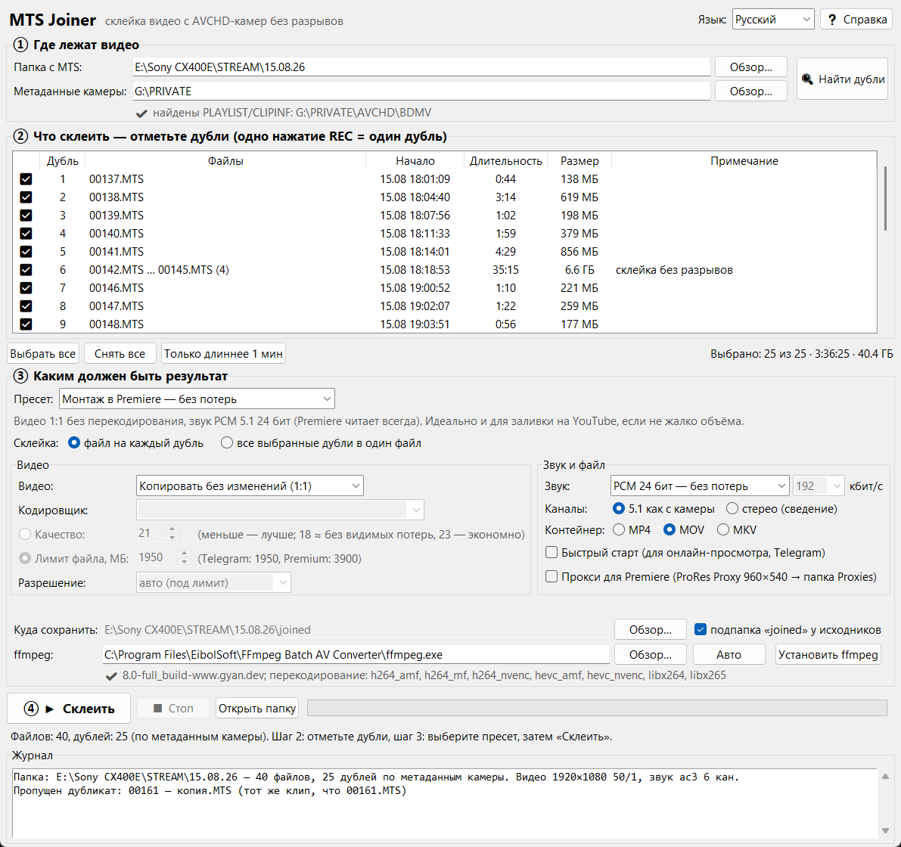

# MTS Joiner — склейка MTS-файлов с камеры в одно видео без потерь

**[English version →](README.en.md)**

Бесплатная программа для Windows: собирает разрезанные камерой файлы `.MTS` (AVCHD — Sony Handycam,
Panasonic, Canon, JVC) обратно в цельные записи — **без перекодирования, без потери качества и без
разрывов на стыках** (никаких чёрных кадров и пропадающего звука в Premiere Pro). Плюс готовые
пресеты для **монтажа в Premiere, YouTube, Telegram** и **компактного хранения (HEVC)**.



**Скачать:** раздел [Releases](../../releases) → `MtsJoiner.exe` (установка не нужна).

---

## Содержание

- [Какую проблему решает](#какую-проблему-решает)
- [Возможности](#возможности)
- [Как пользоваться](#как-пользоваться)
- [Пресеты](#пресеты)
- [Как это работает](#как-это-работает)
- [Что нужно для работы](#что-нужно-для-работы)
- [Какие камеры поддерживаются](#какие-камеры-поддерживаются)
- [Вопросы и ответы (FAQ)](#вопросы-и-ответы-faq)
- [Сборка из исходников](#сборка-из-исходников)

---

## Какую проблему решает

Вы снимаете концерт, свадьбу, лекцию или спектакль на AVCHD-камеру — а на карте вместо одного
часового видео оказываются **файлы по 10 минут**: `00142.MTS`, `00143.MTS`, `00144.MTS`… Камера
режет запись на куски по **2 ГБ** (ограничение файловой системы карты).

Если поставить эти куски в Premiere Pro (или DaVinci Resolve, Vegas и т.п.) подряд, на **каждом
стыке**:

- **~0,77 с чёрного экрана со звуком** в начале куска;
- **~0,77 с картинки без звука** в конце предыдущего.

К этому добавляются тяжёлые файлы на внешнем диске (тормозит предпросмотр) и звук **AC3 5.1**,
который Premiere на свежей Windows 11 может вообще не прочитать.

**MTS Joiner** собирает куски обратно в одну запись **побайтово**, так, как камера их писала, —
стыки исчезают полностью, видео остаётся бит-в-бит как с камеры.

## Возможности

- 🎬 **Склейка без потерь и без разрывов** — видео не перекодируется, битрейт и качество как с камеры.
- 🧠 **Сама находит записи (дубли):** одно нажатие REC = один дубль; длинная запись из нескольких
  файлов собирается автоматически.
- 📋 **Читает метаданные камеры** (`PLAYLIST`/`CLIPINF`): точное время записи, **узнаёт переименованные
  файлы**, **называет пропавшие**, отбрасывает дубликаты («00161 — копия.MTS»).
- 🧩 **Пропал файл?** Запись не теряется: получите части до и после пропуска, без чёрных кадров на краях.
- 📦 **Режимы:** файл на каждый дубль или **весь концерт в один файл**.
- 🎚 **Пресеты:** Premiere (PCM без потерь), Архив (бит-в-бит), YouTube, Telegram (под лимит 2/4 ГБ),
  Экономичный (HEVC, в 3–5 раз меньше).
- 🪶 **Прокси для Premiere** (ProRes Proxy) — плавный монтаж даже с внешнего HDD.
- ⚡ **Видеокарта:** NVIDIA NVENC / AMD AMF / Intel QuickSync выбираются автоматически (только реально
  работающие).
- 🌐 **Русский и английский интерфейс**, подсказки при наведении на каждый элемент, встроенная справка.
- 💾 **Portable:** один `.exe`, без установки; исходные файлы только читаются, никогда не изменяются.

## Как пользоваться

1. Запустите `MtsJoiner.exe`.
2. **① Где лежат видео:** укажите папку с `.MTS` (на карте это `PRIVATE\AVCHD\BDMV\STREAM`) и,
   желательно, **метаданные камеры** — папку `PRIVATE`, `AVCHD` или `BDMV` с карты (или её копию).
   Нажмите **«Найти дубли»**.
3. **② Что склеить:** отметьте ☑ нужные дубли (кнопка «Только длиннее 1 мин» уберёт случайные короткие).
4. **③ Каким должен быть результат:** выберите пресет и режим — файл на каждый дубль или всё в один файл.
5. **④ Склеить.** Готовые файлы появятся в подпапке `joined` рядом с исходниками.

Наведите мышь на любой элемент — появится подсказка. Кнопка **«Справка»** — краткое руководство.

> 💡 Копируя видео с карты, копируйте **всю папку `PRIVATE`**, а не только `STREAM` — так сохранятся
> метаданные камеры, и программа сможет собрать записи максимально точно.

## Пресеты

| Пресет | Видео | Звук | Для чего |
|---|---|---|---|
| **Монтаж в Premiere — без потерь** | копия 1:1 | PCM 5.1 24 бит, MOV | Монтаж. Premiere читает PCM всегда |
| **Архив — бит-в-бит** | копия 1:1 | AC3 5.1 (копия), MP4 | Хранение «как с камеры», минимальный объём без потерь |
| **YouTube — без потерь** | копия 1:1 (≈25 Мбит/с) | AAC 512 кбит/с 5.1, MP4 | Прямая заливка: видео выше рекомендаций YouTube, звук — максимум из них |
| **Telegram — под лимит** | H.264, авто 1080p/720p | AAC 192 кбит/с стерео, MP4 + быстрый старт | Влезает в лимит 2 ГБ (Premium — 4 ГБ); длинное режется на части |
| **Экономичный** | HEVC (H.265) 1080p, качество 23 | AAC 384 кбит/с 5.1, MP4 | В 3–5 раз меньше, визуально почти без потерь |

Любой параметр можно изменить вручную: кодек (копия / H.264 / HEVC), кодировщик, качество (шкала как
у CRF) или лимит размера файла, разрешение, звук PCM / AC3 / AAC и битрейт, 5.1 или стерео,
контейнер MP4 / MOV / MKV, быстрый старт, прокси.

## Как это работает

1. **Анализ.** У каждого файла читаются метки времени видео и звука и формат (через `ffprobe`, а если
   его нет — встроенным анализатором MPEG-TS).
2. **Поиск записей.**
   - **По метаданным камеры.** В `PRIVATE\AVCHD\BDMV\PLAYLIST\*.MPL` камера хранит плейлист: порядок
     клипов, признак «бесшовное продолжение» (`connection_condition = 6`), метку начала каждой записи
     и её **дату и время**. В `CLIPINF\*.CPI` — **точный размер** каждого MTS. Поэтому программа точно
     знает состав каждой записи, узнаёт переименованные файлы по размеру и называет пропавшие.
   - **Без метаданных** — по непрерывности меток времени: у продолжения записи первая метка ровно
     совпадает с концом предыдущего куска (и сверяется время изменения файлов).
3. **Склейка.** Куски записи передаются в ffmpeg как один непрерывный поток (протокол `concat:`), видео
   копируется без изменений. Внутри MPEG-TS звук лежит на ~0,77 с «впереди» видео — при побайтовой
   склейке он встаёт на место, и стыка не остаётся.
4. **Вывод** по выбранному пресету + прокси по желанию.

## Что нужно для работы

- **Windows 10/11, 64 бит.** Установка не нужна — это один portable `.exe`. Настройки хранятся в
  `%APPDATA%\MtsJoiner\settings.json`.
- **ffmpeg** (бесплатный). Если его нет — в программе есть кнопка **«Установить ffmpeg»**
  (через `winget install Gyan.FFmpeg`). Подойдёт и уже установленный:
  - **для склейки без перекодирования и прокси** — любой ffmpeg 6+ (даже урезанный, например из
    Bitwig Studio);
  - **для пресетов Telegram / Экономичный** — ffmpeg с кодировщиками H.264/HEVC: полная сборка
    [gyan.dev](https://www.gyan.dev/ffmpeg/builds/) (`full_build`) или [BtbN](https://github.com/BtbN/FFmpeg-Builds/releases),
    а также ffmpeg из **FFmpeg Batch AV Converter**, **Shutter Encoder** и т.п.;
  - **`ffprobe` не обязателен** — без него работает встроенный анализатор.

  Где программа ищет ffmpeg сама: рядом с `MtsJoiner.exe` (или в `ffmpeg\bin`), установленный через
  winget, `PATH`, `C:\ffmpeg\bin`, FFmpeg Batch AV Converter, Shutter Encoder, Bitwig Studio.
  Путь можно указать вручную.
- **Видеокарта — по желанию.** Программа пробует кодировщики при запуске и по умолчанию берёт
  аппаратный: NVIDIA NVENC → AMD AMF → Intel QuickSync → x264/x265 (процессор).
- **Место на диске:** при склейке без перекодирования — примерно как у исходников (+≈3 ГБ на час
  при звуке PCM). Перед стартом программа оценивает объём и предупредит, если места мало.

## Какие камеры поддерживаются

Любые камеры формата **AVCHD** (`.MTS` / `.M2TS`, папка `PRIVATE\AVCHD\BDMV`):

- **Sony** Handycam HDR-CX, HDR-PJ, FDR-AX (режим AVCHD), NEX / Alpha в режиме AVCHD —
  **проверено на Sony HDR-CX400E**;
- **Panasonic** HC-V, HC-VX, HC-X, HDC, Lumix (AVCHD);
- **Canon** VIXIA / LEGRIA HF; **JVC** Everio (AVCHD-модели).

1080p50/60 и 1080i50/60 (при перекодировании чересстрочное видео автоматически превращается в
50p/60p), звук AC3 5.1, стерео, LPCM. Не подходит для XAVC S (`.MP4`), GoPro и смартфонов —
у них другой формат.

---

## Вопросы и ответы (FAQ)

### Почему камера записала много файлов MTS вместо одного видео?
Так работают все AVCHD-камеры: карта памяти отформатирована в FAT32/exFAT, и камера режет запись на
файлы по 2 ГБ (при 1080p50 это ≈10,5 минут). Это **одна непрерывная запись**, просто разложенная по
файлам. MTS Joiner собирает её обратно.

### Как склеить MTS-файлы с камеры Sony (Panasonic, Canon) в один файл без потери качества?
Укажите в программе папку с MTS, нажмите «Найти дубли», выберите пресет «Монтаж в Premiere» или
«Архив» и нажмите «Склеить». Видео копируется без перекодирования — качество и битрейт остаются
как с камеры.

### Почему в Premiere Pro на стыках MTS-файлов чёрный экран или пропадает звук?
Внутри MTS (MPEG-TS) звук записан примерно на 0,77 с раньше видео, поэтому начало звука следующего
куска физически лежит в конце предыдущего файла и наоборот. Premiere выравнивает каждый файл
отдельно — отсюда ~0,77 с чёрного кадра со звуком и картинки без звука на каждом стыке. После
побайтовой склейки этой программой стыков нет.

### Premiere Pro не видит звук в MTS / нет звука AC3 (Windows 11 24H2)
Premiere использует системный декодер AC3, а в новых сборках Windows 11 его убрали — MTS
импортируется без звука. Выберите пресет **«Монтаж в Premiere»**: звук будет перепакован в
**PCM** (без потерь), и Premiere прочитает его всегда.

### Premiere Pro не открывает MTS-файлы или открывает с ошибками — что делать?
Склейте их в MOV (видео 1:1 + звук PCM) пресетом «Монтаж в Premiere» — это стандартный и самый
надёжный для Premiere вариант.

### Тормозит предпросмотр MTS в Premiere (особенно с внешнего диска) — что делать?
Включите галочку **«Прокси для Premiere»**: программа сделает лёгкие копии ProRes Proxy 960×540.
В Premiere выделите клипы → *Proxy → Attach Proxies* → папка `Proxies`. Монтаж станет плавным,
а экспорт всё равно пойдёт из оригиналов в полном качестве.

### Можно ли просто переименовать MTS-файлы, чтобы камера или Premiere проиграли их как одно видео?
Нет. Плейлист камеры (`PLAYLIST\*.MPL`) ссылается на клипы **по именам**, и переименование его
ломает. Зато MTS Joiner узнаёт переименованные файлы по точному размеру из `CLIPINF` и ставит их на
место.

### Что такое папки PLAYLIST и CLIPINF, файлы .MPL, .CPI, .BDM на карте камеры? Их можно удалить?
Это служебные файлы формата AVCHD — «инструкция для воспроизведения»: какие файлы составляют каждую
запись, в каком порядке, когда она снята, сколько весит каждый файл. Удалять их не нужно —
наоборот, **копируйте всю папку `PRIVATE`**: с ней программа соберёт записи точнее всего.

### Я скопировал только папку STREAM с MTS-файлами — программа справится?
Да. Без метаданных записи определяются по меткам времени внутри самих файлов. Главное — не
переименовывать файлы (номерные имена `00142.MTS` нужны для порядка). Если карта ещё не
отформатирована, укажите её папку `PRIVATE` как «Метаданные камеры» — будет ещё точнее.

### Один файл из записи потерялся или повреждён — что будет?
Пропавший кусок восстановить невозможно, но остальное не потеряется. Запись покажется частями
(например, `6.1` и `6.2`) с пометкой «⚠ нет файла 00144 (≈10:35)». В режиме «файл на каждый дубль»
получится два файла, в режиме «все в один файл» части склеятся встык. Края возле пропуска
аккуратно подрезаются, чтобы не было чёрного экрана со звуком.

### Как сделать из MTS файл MP4 или MOV без перекодирования?
Пресет «Архив» (MP4, видео и звук бит-в-бит) или «Монтаж в Premiere» (MOV, видео 1:1 + PCM).
Это быстро — по сути копирование: 35 минут записи склеиваются примерно за 2–3 минуты (зависит от
скорости диска).

### Как отправить длинное видео в Telegram (лимит 2 ГБ)?
Пресет **«Telegram — под лимит»**: программа сама подберёт битрейт, чтобы файл влез в 2 ГБ (с
Premium — укажите 3900 МБ), при нехватке битрейта уменьшит картинку до 720p, а очень длинную
запись разрежет на части. Включён «быстрый старт» — видео начинает играть в чате сразу.

### В каком формате загружать видео с камеры на YouTube, чтобы не потерять качество?
Пресет **«YouTube — без потерь»**: видео не перекодируется (≈25 Мбит/с — выше рекомендаций YouTube
для 1080p50), звук AAC 512 кбит/с. YouTube всё равно пережимает видео у себя, поэтому отдать ему
что-то лучше исходника нельзя. Можно грузить и MOV из пресета «Монтаж» (звук PCM без потерь).

### Как уменьшить размер видео с камеры без заметной потери качества?
Пресет **«Экономичный»**: HEVC (H.265) с постоянным качеством — обычно в 3–5 раз меньше оригинала
при визуально почти том же качестве. Качество регулируется (меньше число — лучше).

### Как перевести звук AC3 5.1 в стерео или в PCM?
В блоке «Звук и файл»: «PCM 24 бит» или «AAC» и переключатель «стерео (сведение)».

### Нужно ли устанавливать программу? Нужен ли установщик?
Нет. Это один portable-файл `MtsJoiner.exe` — скачал и запустил. Нужен только бесплатный ffmpeg
(кнопка «Установить ffmpeg» поставит его за минуту). Windows SmartScreen может предупредить о
неизвестном издателе (файл не подписан): «Подробнее» → «Выполнить в любом случае».

### Какой ffmpeg нужен? Подойдёт ли ffmpeg из FFmpeg Batch AV Converter, Shutter Encoder, Bitwig?
Подойдёт любой. Для склейки и прокси хватит любого ffmpeg 6+, для Telegram/Экономичного нужен
ffmpeg с H.264/HEVC-кодировщиками (полные сборки — gyan.dev, BtbN, а также ffmpeg из FFmpeg Batch AV
Converter). `ffprobe` не обязателен. Укажите `ffmpeg.exe` кнопкой «Обзор…» или нажмите «Авто».

### Почему не используется видеокарта / не работает NVENC?
Программа проверяет каждый кодировщик пробным запуском и показывает только рабочие. Свежие сборки
ffmpeg требуют свежий драйвер NVIDIA (ffmpeg 9 — драйвер 610+). Обновите драйвер или укажите
ffmpeg постарше (например, 8.x) — тогда NVENC появится в списке.

### Программа изменяет или удаляет мои исходные файлы?
Нет. Исходные MTS и метаданные только читаются; результат пишется в отдельную папку.

### Чем это лучше, чем `copy /b 1.MTS+2.MTS` или склейка в самом Premiere?
`copy /b` склеивает байты, но вы сами должны знать, какие файлы относятся к одной записи, звук
останется AC3, а пропуски и переименования никто не проверит. Склейка в Premiere оставляет разрывы
на стыках. MTS Joiner сам определяет записи (по метаданным камеры), проверяет полноту, делает MP4/MOV
с нужным звуком, прокси и версии для YouTube/Telegram.

### В готовом видео остались чёрные кадры — это ошибка склейки?
Проверьте оригинал: на концертах тёмные моменты (свет погашен) — это реальные чёрные кадры. Склейка
своих не добавляет: мы проверяли стыки покадрово (без чёрных кадров, без тишины, без ошибок
декодирования).

---

## Сборка из исходников

Python 3.12+ (только стандартная библиотека, интерфейс — tkinter):

```powershell
py MtsJoiner.pyw              # запуск из исходников
py -m pip install pyinstaller
.\build.bat                   # → dist\MtsJoiner.exe
```

Устройство:

- `mtsjoiner/avchd.py` — чтение `PLAYLIST\*.MPL` (PlayItem, connection_condition, PlayListMark,
  дата/время из расширения PLEX) и `CLIPINF\*.CPI` (размер, время начала/конца);
- `mtsjoiner/tsprobe.py` — встроенный анализатор MPEG-TS (PAT/PMT, PTS) — работа без ffprobe;
- `mtsjoiner/core.py` — поиск ffmpeg и проверка кодировщиков, группировка в дубли, пресеты, расчёт
  битрейта под лимит, команды ffmpeg, запуск с прогрессом;
- `mtsjoiner/i18n.py` — тексты интерфейса (RU/EN) и справка;
- `mtsjoiner/app.py` — окно программы.

## Ограничения

- Пропавший файл восстановить нельзя — склеивается то, что осталось.
- В режиме «всё в один файл» между разными дублями — обычная склейка (камера в это время не писала).
- MKV Premiere не импортирует — он для архива и плееров.

---

*Ключевые слова: склеить MTS файлы, объединить MTS в один файл, камера записала много файлов,
видео разбито на части по 2 ГБ, AVCHD склейка без потерь, MTS в MP4 без перекодирования, Premiere Pro
MTS чёрный кадр на стыке, Premiere нет звука AC3, Sony Handycam HDR-CX склеить видео, Panasonic
HC-V MTS, Canon LEGRIA MTS, конвертер MTS для YouTube и Telegram, прокси для Premiere.*
